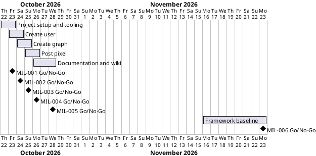

# Project Plan

## Metadata
| Key | Value |
| --- | --- |
| ID | PP-001 |
| CrossReference | [BC-001], [SA-001], [MIL-001], [MIL-002], [MIL-003], [MIL-004], [MIL-005], [MIL-006] |
| Language | en |
| Domain | education |

## Version History
| Date | Status | Author | Reviewer | Change | Commit |
| --- | --- | --- | --- | --- | --- |
| 2026-10-22 | Deprecated | Jens Tirsvad Nielsen | AI as stand-in for S01 | Final state: milestone links, open issues of the wiki | [9bcbccb] |
| 2026-10-22 | Deprecated | Jens Tirsvad Nielsen | AI as stand-in for S01 | Open issue: S01 accepted the Danish and Bahasa Malaysia wiki translations | [5255a41] |
| 2026-11-16 | Accepted | Jens Tirsvad Nielsen | AI as stand-in for S01 | Added the baseline gateway (MIL-006) with its schedule row, scope coverage, dependency, risk and Gantt entries; noted which Open Issues are superseded (the project publish-wiki workflow was removed when the shared workflows of the git host took over); set the domain to education; reviewed in autonomous mode, not independent | pending |

---

## Purpose

The plan schedules the five gateways (and, later, the baseline gateway) that take the Habit Tracker from an empty repository to a documented project, within the two-day effort and the one-branch-per-milestone constraint of [BC-001].

## Planning Assumptions

- The plan starts on 2026-10-22 and ends by 2026-10-28, per the Business Case constraint of about two days of work spread over a week.
- The baseline gateway ([MIL-006]) starts 2026-11-16 and ends 2026-11-23, one week, as the Business Case constraint for it requires. It brings the finished project to the baseline of the framework (decision of S01); the first five gateways keep their dates.
- One gateway is built on one branch and merged by one pull request, so the steps stay traceable. The documents of the plan itself are merged first, by a plan pull request that closes no issue.
- S01 accepts the plan in chat (autonomous mode); the AI reviews each artifact as stand-in for S01 and records it as not independent.
- The milestones are published to the git host by `sync-project.sh --apply` after the plan is accepted, because the project does not install the framework's publish workflow.

## Gateway Schedule

| Gateway | Document | Window | Decision date | Owner | Stories | Main deliverable | Milestone |
| --- | --- | --- | --- | --- | --- | --- | --- |
| Project setup and tooling | [MIL-001] | 2026-10-22 to 2026-10-23 | 2026-10-23 | S01 | none (ADR-0002) | pyproject, .gitignore, Doxyfile, constants.py, first README, workflows, description and topics | [MIL-001 milestone] |
| Create user | [MIL-002] | 2026-10-23 to 2026-10-24 | 2026-10-24 | S01 | none (ADR-0002) | `create_user`, layers, adapters, create-user command | [MIL-002 milestone] |
| Create graph | [MIL-003] | 2026-10-24 to 2026-10-25 | 2026-10-25 | S01 | none (ADR-0002) | `create_graph`, create-graph command | [MIL-003 milestone] |
| Post pixel | [MIL-004] | 2026-10-25 to 2026-10-26 | 2026-10-26 | S01 | none (ADR-0002) | `post_pixel`, post-pixel command | [MIL-004 milestone] |
| Documentation and wiki | [MIL-005] | 2026-10-26 to 2026-10-28 | 2026-10-28 | S01 | none (ADR-0002) | README, screenshots, wiki in three languages, Doxygen | [MIL-005 milestone] |
| Framework baseline | [MIL-006] | 2026-11-16 to 2026-11-23 | 2026-11-23 | S01 | none (ADR-0002) | The adopted framework release, the wiki sidebar in the framework's shape, the README, licence metadata, the two repaired static tests, the traceability matrix and review records | [MIL-006 milestone] |



## Scope Coverage

| Business Case scope item | Gateway |
| --- | --- |
| Python 3.13+, `.venv`, `pyproject.toml`, `.gitignore`, pytest | [MIL-001] |
| Create a Pixela user (POST) | [MIL-002] |
| Create a graph (POST with token header) | [MIL-003] |
| Post a pixel (POST with date and quantity) | [MIL-004] |
| Command line with dry run | [MIL-002], [MIL-003], [MIL-004] |
| `constants.py`, Doxygen comments, `Doxyfile` | [MIL-001], [MIL-005] |
| README from the framework template, wiki in three languages, screenshots | [MIL-005] |
| Shared workflows, description and topics | [MIL-001], [MIL-005] |
| The baseline: framework release, wiki sidebar, README, licence metadata, repaired static tests, traceability matrix, review records | [MIL-006] |

## Dependencies

```
MIL-001 → MIL-002 → MIL-003 → MIL-004 → MIL-005 → MIL-006
```

A No-Go on a gateway moves every later date by the time of the rework; the end date 2026-10-28 is then renegotiated with S01. A No-Go on [MIL-006] leaves the program and the earlier gateways as they are.

## Plan Risks

| Risk | Impact | Mitigation |
| --- | --- | --- |
| The shared workflows cannot run because the runner or the secrets are missing | The checks stay unproven in CI | The same checks run locally before each pull request and the missing secrets are listed in the README and in the run summary |
| The Bahasa Malaysia and Danish translations are not read by a native speaker | Wrong wording | The records of the language checks stay `Go-with-conditions` until a person who reads the language has checked them |
| `doxygen` is not installed on the author's machine | The Doxygen criterion cannot be checked | The run uses a portable binary if available, otherwise the criterion is reported as not verified |
| A continuous integration (CI) check fails on the pull request of [MIL-006] | The merge is delayed past 2026-11-23 | The failure is fixed on the same branch and the checks run again; after three failed rounds on one cause the work stops and S01 decides (trace: success criterion 8 of [BC-001]) |

## Open Issues

- Whether the shared workflows should also be installed on the GitHub mirror is left to S01.
- The secret `TOKEN_FOR_GITEA_WIKI` is not set by the AI; S01 sets it in the organisation before the wiki can be published.
- The Danish and Bahasa Malaysia wiki pages were written by the AI. S01 accepted them in chat on 2026-10-22; no native-speaker review is recorded.
- No real Pixela account is created for screenshots; the screenshots show the dry run and the tests.
- The second Open Issue (the secret `TOKEN_FOR_GITEA_WIKI`) is superseded: the commit "Use git-workflows and the scoped workflows" (pull request #40) removed `.gitea/workflows/publish-wiki.yml`, because the shared workflows of the git host publish `docs/wiki/`; the task that added it stays in [MIL-005] as the accepted record. The same commit moved the callers to the shared repository `TirSystem/git-workflows`; the earlier documents still name it `TirSystem/github-action`.
- Criterion 4 of [MIL-005] (the sidebar lists all languages) is met in a new shape since [MIL-006]: the sidebar has one list of the English pages and a Languages section with the Home page of each language, as the framework's wiki checklist requires.
- The plan was accepted without a QC checklist until [MIL-006]; since then it is reviewed against `QC-PP-001` (RC-033).
- Domain: since [MIL-006] the plan, the Business Case and the baseline milestone have the domain `education`. The other documents (Stakeholder Analysis, milestones MIL-001 to MIL-005 and the review records RC-001 to RC-031) keep the domain `it` they were accepted with; they are not changed by the baseline, and a change of their domain would need a new review of each.

---

[BC-001]: ./business-case.md
[SA-001]: ./stakeholder-analysis.md
[MIL-001]: ./milestones/mil-001-project-setup.md
[MIL-002]: ./milestones/mil-002-create-user.md
[MIL-003]: ./milestones/mil-003-create-graph.md
[MIL-004]: ./milestones/mil-004-post-pixel.md
[MIL-005]: ./milestones/mil-005-docs-and-wiki.md
[MIL-001 milestone]: https://git.tirsystem.com/Tirsvad-Udemy-100-days-of-code/037-habit-tracker/milestone/223
[MIL-002 milestone]: https://git.tirsystem.com/Tirsvad-Udemy-100-days-of-code/037-habit-tracker/milestone/224
[MIL-003 milestone]: https://git.tirsystem.com/Tirsvad-Udemy-100-days-of-code/037-habit-tracker/milestone/225
[MIL-004 milestone]: https://git.tirsystem.com/Tirsvad-Udemy-100-days-of-code/037-habit-tracker/milestone/226
[MIL-005 milestone]: https://git.tirsystem.com/Tirsvad-Udemy-100-days-of-code/037-habit-tracker/milestone/227
[9bcbccb]: https://git.tirsystem.com/Tirsvad-Udemy-100-days-of-code/037-habit-tracker/commit/9bcbccb233e7c7c8a4ec84afcc93a44e666fe715
[5255a41]: https://git.tirsystem.com/Tirsvad-Udemy-100-days-of-code/037-habit-tracker/commit/5255a41406e0221209c9305e555fc32b1eb9d95c
[MIL-006]: ./milestones/mil-006-framework-baseline.md
[MIL-006 milestone]: https://git.tirsystem.com/Tirsvad-Udemy-100-days-of-code/037-habit-tracker/milestone/552
