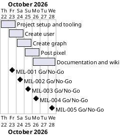

# Project Plan

## Metadata
| Key | Value |
| --- | --- |
| ID | PP-001 |
| CrossReference | [BC-001], [SA-001], [MIL-001], [MIL-002], [MIL-003], [MIL-004], [MIL-005] |
| Language | en |
| Domain | it |

## Version History
| Date | Status | Author | Reviewer | Change | Commit |
| --- | --- | --- | --- | --- | --- |
| 2026-10-22 | Accepted | Jens Tirsvad Nielsen | S01 (accepted in chat) | Initial version | [08a6fcc] |

---

## Purpose

The plan schedules the five gateways that take the Habit Tracker from an empty repository to a documented project, within the two-day effort and the one-branch-per-milestone constraint of [BC-001].

## Planning Assumptions

- The plan starts on 2026-10-22 and ends by 2026-10-28, per the Business Case constraint of about two days of work spread over a week.
- One gateway is built on one branch and merged by one pull request, so the steps stay traceable. The documents of the plan itself are merged first, by a plan pull request that closes no issue.
- S01 accepts the plan in chat (autonomous mode); the AI reviews each artifact as stand-in for S01 and records it as not independent.
- The milestones are published to the git host by `sync-project.sh --apply` after the plan is accepted, because the project does not install the framework's publish workflow.

## Gateway Schedule

| Gateway | Document | Window | Decision date | Owner | Stories | Main deliverable | Milestone |
| --- | --- | --- | --- | --- | --- | --- | --- |
| Project setup and tooling | [MIL-001] | 2026-10-22 to 2026-10-23 | 2026-10-23 | S01 | none (ADR-0002) | pyproject, .gitignore, Doxyfile, constants.py, first README, workflows, description and topics | |
| Create user | [MIL-002] | 2026-10-23 to 2026-10-24 | 2026-10-24 | S01 | none (ADR-0002) | `create_user`, layers, adapters, create-user command | |
| Create graph | [MIL-003] | 2026-10-24 to 2026-10-25 | 2026-10-25 | S01 | none (ADR-0002) | `create_graph`, create-graph command | |
| Post pixel | [MIL-004] | 2026-10-25 to 2026-10-26 | 2026-10-26 | S01 | none (ADR-0002) | `post_pixel`, post-pixel command | |
| Documentation and wiki | [MIL-005] | 2026-10-26 to 2026-10-28 | 2026-10-28 | S01 | none (ADR-0002) | README, screenshots, wiki in three languages, Doxygen | |



## Scope Coverage

| Business Case scope item | Gateway |
| --- | --- |
| Python 3.13+, `.venv`, `pyproject.toml`, `.gitignore`, pytest | [MIL-001] |
| Create a Pixela user (POST) | [MIL-002] |
| Create a graph (POST with token header) | [MIL-003] |
| Post a pixel (POST with date and quantity) | [MIL-004] |
| Command line with dry run | [MIL-002], [MIL-003], [MIL-004] |
| `constants.py`, Doxygen comments, `Doxyfile` | [MIL-001], [MIL-005] |
| README from the framework template, wiki in three languages, screenshots | [MIL-005] |
| Shared workflows, description and topics | [MIL-001], [MIL-005] |

## Dependencies

```
MIL-001 → MIL-002 → MIL-003 → MIL-004 → MIL-005
```

A No-Go on a gateway moves every later date by the time of the rework; the end date 2026-10-28 is then renegotiated with S01.

## Plan Risks

| Risk | Impact | Mitigation |
| --- | --- | --- |
| The shared workflows cannot run because the runner or the secrets are missing | The checks stay unproven in CI | The same checks run locally before each pull request and the missing secrets are listed in the README and in the run summary |
| The Bahasa Malaysia and Danish translations are not read by a native speaker | Wrong wording | The records of the language checks stay `Go-with-conditions` until a person who reads the language has checked them |
| `doxygen` is not installed on the author's machine | The Doxygen criterion cannot be checked | The run uses a portable binary if available, otherwise the criterion is reported as not verified |

## Open Issues

- Whether the shared workflows should also be installed on the GitHub mirror is left to S01.
- No real Pixela account is created for screenshots; the screenshots show the dry run and the tests.

---

[BC-001]: ./business-case.md
[SA-001]: ./stakeholder-analysis.md
[MIL-001]: ./milestones/mil-001-project-setup.md
[MIL-002]: ./milestones/mil-002-create-user.md
[MIL-003]: ./milestones/mil-003-create-graph.md
[MIL-004]: ./milestones/mil-004-post-pixel.md
[MIL-005]: ./milestones/mil-005-docs-and-wiki.md
[08a6fcc]: https://git.tirsystem.com/Tirsvad-Udemy-100-days-of-code/037-habit-tracker/commit/08a6fcc2c14667fa77bf15d126c00b34200252b5
